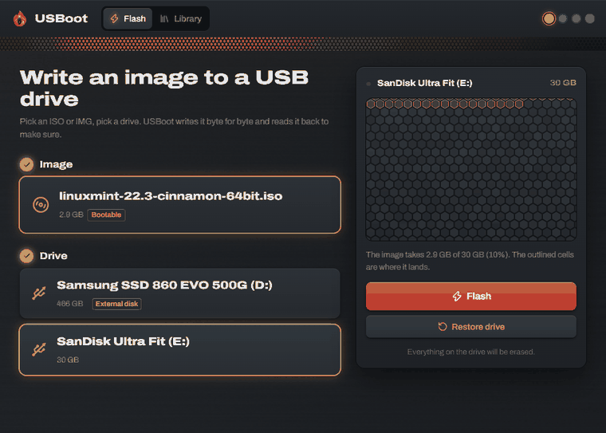
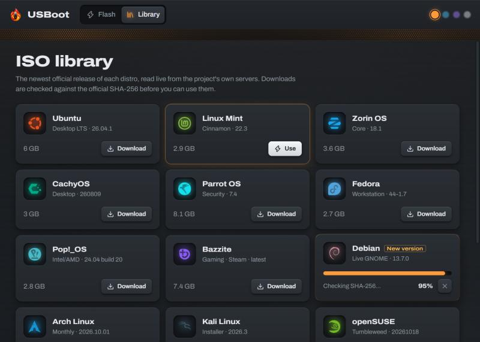

<p align="center">
  
</p>

<h1 align="center">USBoot</h1>

<p align="center">
  Make bootable USB drives — Linux or Windows — from a <b>3 MB</b> app. Every byte verified.
</p>

<p align="center">
  <a href="https://github.com/bernaljeanp/usboot/releases/latest"><b>⬇ Download for Windows</b></a>
  &nbsp;·&nbsp; Windows 10 / 11 x64 &nbsp;·&nbsp; Linux &amp; macOS (beta) &nbsp;·&nbsp; English / Español
</p>

<p align="center">
  
</p>

## Install

- **Windows:** [download the installer](https://github.com/bernaljeanp/usboot/releases/latest) — or `winget install bernaljeanp.USBoot` (once the winget review is done)
- **macOS (beta, Apple Silicon):** `brew install --cask --no-quarantine bernaljeanp/tap/usboot`
- **Linux (beta):** `.deb` or `.AppImage` from the [latest release](https://github.com/bernaljeanp/usboot/releases/latest)

## What it does

- **Flash any ISO or IMG** byte for byte, then **read it all back** and compare. A bad or fake drive can't hide.
- **Windows mode** — a Windows install ISO doesn't boot when copied raw. USBoot builds a UEFI drive (GPT + FAT32) and splits `install.wim` with DISM so it fits, like Rufus.
- **Windows 11 options** — install on PCs without TPM 2.0 / Secure Boot, create a local user with no Microsoft account, skip the privacy questions (written as `autounattend.xml`).
- **Several drives at once** — the same image onto every stick in parallel, each one verified on its own.
- **Compressed images** — `.img.xz`, `.gz` and `.zst` (Raspberry Pi OS, SteamOS…) are unpacked once, then written and verified.
- **Updates itself** from signed GitHub releases.
- **ISO library** — 20 sources, always the newest official release, read live from each project's own checksum file: Ubuntu, Kubuntu, Xubuntu, Ubuntu Server, Linux Mint, Zorin OS, Pop!_OS, Fedora, CachyOS, Bazzite, Debian, Arch, openSUSE, Rocky, Alma, Kali, Parrot OS, Tails, Proxmox VE (and a link to Windows 11).
- **Fast downloads** — measures the official mirrors, drops the slow ones and pulls 8 MB ranges from several at once. Then checks the **SHA-256**; a download that doesn't match is deleted, never kept.
- **Live sector map** (WebGL) — the drive as a honeycomb of sectors that ignite as they're written and cool down as they're verified.
- **Restore drive** — one click back to a normal drive (exFAT / NTFS / FAT32, full capacity). Fixes the "my 32 GB stick shows 4 MB" after flashing Linux.

<p align="center">
  
</p>

## Safety

USBoot only lists **USB** disks, never the disk Windows runs from. Drives bigger than a typical stick are flagged as *external disk* with an extra warning. Right before erasing, it checks the drive is still exactly the one you picked (number, serial and size) — unplug and plug in something else, and it stops.

## Linux & macOS (beta)

Same app, same features except Windows mode. It runs as your user and asks for your password once per drive through the system dialog (pkexec / macOS admin prompt), only to unmount the disk and hand you its device. On Linux, replug the stick when it's done. Feedback very welcome.

## Why not Etcher / Rufus?

| | USBoot | balenaEtcher | Rufus |
|---|---|---|---|
| Download size (Windows) | **3 MB** | ~150 MB | ~1.5 MB |
| Verifies after writing | ✅ | ✅ | — |
| Windows ISOs | ✅ | — | ✅ |
| Built-in ISO library with checksums | ✅ | — | Windows only |
| Multi-mirror downloads | ✅ | — | — |
| Restore drive to normal | ✅ | — | ✅ |
| Several drives at once | ✅ | ✅ | — |
| Windows 11 without TPM / Microsoft account | ✅ | — | ✅ |
| Windows · Linux · macOS | ✅ | ✅ | Windows only |
| Telemetry | none | yes | none |

> The installer isn't code-signed yet, so Windows SmartScreen may say *Windows protected your PC*. Click **More info → Run anyway**.

## Build from source

Requires Rust, Node 20+ and the [Tauri prerequisites](https://tauri.app/start/prerequisites/).

```bash
npm install
npm run tauri dev      # development (runs unelevated: writing drives needs the release build)
npm run tauri build    # installer (requests admin)
cd src-tauri && cargo test
cargo test -- --ignored   # online checks: every distro resolves, mirror download
```

`npm run dev` and open `/preview.html` to run the whole UI in a browser with the Rust side simulated.

Built with [Tauri 2](https://tauri.app) (Rust) and React. Sibling of [Purge](https://github.com/bernaljeanp/purge).

## License

Apache-2.0. Distro marks from [Simple Icons](https://simpleicons.org) (CC0); Bazzite mark from its [press kit](https://github.com/ublue-os/bazzite).
